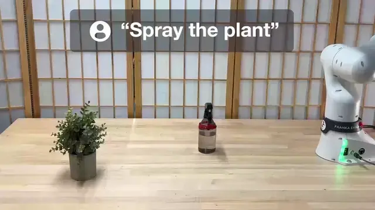
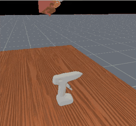
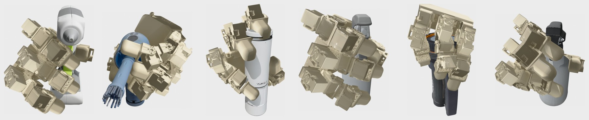

# CoDex: Learning Compositional Dexterous Functional Manipulation without Demonstrations

[**Website**](https://robin-lab.cs.utexas.edu/CoDex/) | [**Paper**](https://arxiv.org/abs/2606.31909)

CoDex teaches a dexterous hand to use a functional object (spray a plant, glue blocks, grind salt) without demonstrations. A vision-language model turns the task into keypoints on the object and a goal pose relative to the target. CoDex then generates grasps that keep one finger on the object's trigger and refines the whole grasp, carry and press with reinforcement learning in ManiSkill3, using a LEAP hand.

<p align="center"></p>

## Installation

Linux with conda and an NVIDIA GPU (CUDA ≥ 11.8 driver; defaults are sized for 24 GB).

```bash
git clone https://github.com/UT-Austin-RobIn/CoDex.git && cd CoDex
bash install.sh --env-name codex --no-foundationpose  # for the bundled scenes
conda activate codex
export OPENAI_API_KEY=...           # keypoints and goal pose; TRIPO_API_KEY for meshes of new captures
```

Keys can also be saved from the app, to `.api_keys.json` (gitignored); environment variables take precedence.

Omit `--no-foundationpose` to create scenes from new captures.

The script verifies the install; for a step-by-step alternative see [docs/MANUAL_INSTALL.MD](docs/MANUAL_INSTALL.MD).

## Quick start

The app runs each stage, shows keypoints, goal pose and grasps in interactive 3D, and plots training as it runs:

```bash
python scripts/app.py               # http://localhost:7860
```

The same stages from a terminal, on a bundled example scene:

```bash
python scripts/0_create_scene.py    --scene-name demo --from-scene assets/scenes/grey_spray_bottle_plant
python scripts/1_estimate_keypoints.py --scene-dir out/scenes/demo
python scripts/2_generate_goal.py   --scene-dir out/scenes/demo
python scripts/3_generate_grasps.py --scene-dir out/scenes/demo
WANDB_MODE=offline python scripts/4_train_policy.py --scene-dir out/scenes/demo --total-timesteps 400000
python scripts/5_evaluate_policy.py --scene-dir out/scenes/demo
```

No API key? Add `--copy-outputs` to the first command to reuse the example's keypoints, goal pose and grasps, and start at stage 3 or 4.

| Stage | What it does | Needs | Writes to the scene folder |
|---|---|---|---|
| 0 Scene | Segments the capture, builds and registers the object mesh | RGB-D capture (optionally with your own mesh), or use our [provided example scene](assets/scenes/grey_spray_bottle_plant) | `scene.pkl`, `mesh/`, `mesh_coacd/`, `pose.txt` |
| 1 Keypoints | Finds the actuation point, functional point and target | OpenAI key | `keypoints/fn_key_pts.json` |
| 2 Goal pose | Searches the object's pose relative to the target | OpenAI key | `goal_gen/vlm_cem_dir/` |
| 3 Grasps | Optimises grasps for the motion, ranks them in simulation | GPU, ~10 min | `grasps/` |
| 4 Training | Learns corrections to a grasp with PPO, on the full carry-and-press task | GPU; runtime varies by scene and settings | `rl_runs/<run>/` |
| 5 Evaluation | Carries the object to the goal pose and presses, on fresh episodes | GPU | `evals/<run>/` |

Each stage can be re-run or replaced on its own; options and file formats are in [docs/USAGE.MD](docs/USAGE.MD).

## Results on the example scenes

<p align="center"></p>

The hand must grasp the functional object, carry it to the target pose, hold it steady and press its actuation point. Each score is the success rate over 128 simulated trials with varied object properties and hand placement.

*Grasp alone* uses the generated grasp. *After training* adds a learned policy that corrects the hand's motion.

<p align="center"></p>

| Scene | Task | Grasp alone | After training |
|---|---|---:|---:|
| `grey_spray_bottle_plant` | spray the plant | 44% | 97% |
| `salt_grinder_beans` | grind salt on the beans | 27% | 98% |
| `hot_glue_gun_wooden_blocks` | glue the blocks | 74% | 97% |
| `black_spray_bottle_white_board` | spray the whiteboard | 40% | 96% |
| `air_blower_keyboard` | clean the keyboard | 37% | 92% |
| `flash_light_sloth` | illuminate the toy | 5% | 91% |

The simulation measures pressing through fingertip force at a marked point on the mesh. Real-robot deployment requires separate validation.

## Repository layout

```
scripts/        one entry point per stage (0-5) and the app
codex/
├── scene/      capture, segmentation, camera extrinsics
├── mesh/       image-to-mesh, CoACD, pose registration
├── keypoint_estimation/   actuation, functional and target points
├── goal_gen/   goal-pose search
├── grasp_gen/  grasp generation and simulated selection
└── codex_train/           ManiSkill3 environment, training, evaluation
assets/         example scenes and the LEAP hand model
docs/           usage guide, installation, mesh creation
```

## Questions

**How do I use my own object?** Capture an RGB-D frame with the functional object, the target and the table, then `python scripts/0_create_scene.py --scene-name mine --image rgb.png --points pts.npy --intrinsics K.npy --task "..."`. Check each stage's output before running the next.

**How can I reduce GPU memory use?** Lower `--num-candidates`/`--screen-envs` in stage 3 and `--num-envs` in stage 4.

**Does this include the real robot?** No. The trained policy runs the grasp, carry and press in simulation; deploying it needs your own robot stack, and our Franka + LEAP code is hardware-specific.

## Citation

```bibtex
@inproceedings{jiang2026codex,
  title     = {CoDex: Learning Compositional Dexterous Functional Manipulation without Demonstrations},
  author    = {Jiang, Bowen and Reger, William Painter and Mart{\'i}n-Mart{\'i}n, Roberto},
  booktitle = {IEEE International Conference on Robotics and Automation (ICRA)},
  year      = {2026}
}
```

## Acknowledgments

Simulation uses [ManiSkill3](https://github.com/haosulab/ManiSkill), segmentation [LangSAM](https://github.com/luca-medeiros/lang-segment-anything), pose registration [FoundationPose](https://github.com/NVlabs/FoundationPose), and optional local pointing [MolmoPoint](https://huggingface.co/allenai/MolmoPoint-8B).

## License

Original CoDex code is licensed under [MIT](LICENSE).
